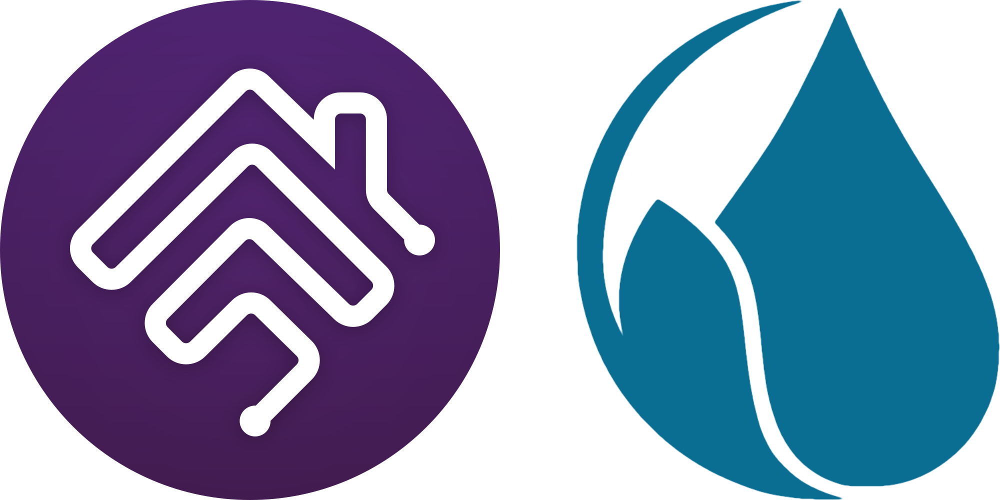

<!-- MASTHEAD:BEGIN - Auto-generated by homebridge-plugin-utils. Do not edit this region by hand. -->

# Homebridge Hunter Hydrawise

[![verified-by-homebridge](https://img.shields.io/badge/homebridge-verified-blueviolet?color=%2357277C&style=for-the-badge&logoColor=%23FFFFFF&logo=data:image/svg%2bxml;base64,PHN2ZyB4bWxucz0iaHR0cDovL3d3dy53My5vcmcvMjAwMC9zdmciIHdpZHRoPSI5OTIuMDkiIGhlaWdodD0iMTAwMCIgdmlld0JveD0iMCAwIDk5Mi4wOSAxMDAwIj48ZGVmcz48c3R5bGU+LmF7ZmlsbDojZmZmO308L3N0eWxlPjwvZGVmcz48cGF0aCBjbGFzcz0iYSIgZD0iTTk1MC4xOSw1MDguMDZhNDEuOTEsNDEuOTEsMCwwLDEtNDItNDEuOWMwLS40OC4zLS45MS4zLTEuNDJMODI1Ljg2LDM4Mi4xYTc0LjI2LDc0LjI2LDAsMCwxLTIxLjUxLTUyVjEzOC4yMmExNi4xMywxNi4xMywwLDAsMC0xNi4wOS0xNkg3MzYuNGExNi4xLDE2LjEsMCwwLDAtMTYsMTZWMjc0Ljg4bC0yMjAuMDktMjEzYTE2LjA4LDE2LjA4LDAsMCwwLTIyLjY0LjE5TDYyLjM0LDQ3Ny4zNGExNiwxNiwwLDAsMCwwLDIyLjY1bDM5LjM5LDM5LjQ5YTE2LjE4LDE2LjE4LDAsMCwwLDIyLjY0LDBMNDQzLjUyLDIyNS4wOWE3My43Miw3My43MiwwLDAsMSwxMDMuNjIuNDVMODYwLDUzOC4zOGE3My42MSw3My42MSwwLDAsMSwwLDEwNGwtMzguNDYsMzguNDdhNzMuODcsNzMuODcsMCwwLDEtMTAzLjIyLjc1TDQ5OC43OSw0NjguMjhhMTYuMDUsMTYuMDUsMCwwLDAtMjIuNjUuMjJMMjY1LjMsNjgwLjI5YTE2LjEzLDE2LjEzLDAsMCwwLDAsMjIuNjZsMzguOTIsMzlhMTYuMDYsMTYuMDYsMCwwLDAsMjIuNjUsMGwxMTQtMTEyLjM5YTczLjc1LDczLjc1LDAsMCwxLDEwMy4yMiwwbDExMywxMTEsLjQyLjQyYTczLjU0LDczLjU0LDAsMCwxLDAsMTA0TDU0NS4wOCw5NTcuMzV2LjcxYTQxLjk1LDQxLjk1LDAsMSwxLTQyLTQxLjk0Yy41MywwLC45NS4zLDEuNDQuM0w2MTYuNDMsODA0LjIzYTE2LjA5LDE2LjA5LDAsMCwwLDQuNzEtMTEuMzMsMTUuODUsMTUuODUsMCwwLDAtNC43OS0xMS4zMmwtMTEzLTExMWExNi4xMywxNi4xMywwLDAsMC0yMi42NiwwTDM2Ny4xNiw3ODIuNzlhNzMuNjYsNzMuNjYsMCwwLDEtMTAzLjY3LS4yN2wtMzktMzlhNzMuNjYsNzMuNjYsMCwwLDEsMC0xMDMuODZMNDM1LjE3LDQyNy44OGE3My43OSw3My43OSwwLDAsMSwxMDMuMzctLjlMNzU4LjEsNjM5Ljc1YTE2LjEzLDE2LjEzLDAsMCwwLDIyLjY2LDBsMzguNDMtMzguNDNhMTYuMTMsMTYuMTMsMCwwLDAsMC0yMi42Nkw1MDYuNSwyNjUuOTNhMTYuMTEsMTYuMTEsMCwwLDAtMjIuNjYsMEwxNjQuNjksNTgwLjQ0QTczLjY5LDczLjY5LDAsMCwxLDYxLjEsNTgwTDIxLjU3LDU0MC42OWwtLjExLS4xMmE3My40Niw3My40NiwwLDAsMSwuMTEtMTAzLjg4TDQzNi44NSwyMS40MUE3My44OSw3My44OSwwLDAsMSw1NDAsMjAuNTZMNjYyLjYzLDEzOS4zMnYtMS4xYTczLjYxLDczLjYxLDAsMCwxLDczLjU0LTczLjVINzg4YTczLjYxLDczLjYxLDAsMCwxLDczLjUsNzMuNVYzMjkuODFhMTYsMTYsMCwwLDAsNC43MSwxMS4zMmw4My4wNyw4My4wNWguNzlhNDEuOTQsNDEuOTQsMCwwLDEsLjA4LDgzLjg4WiIvPjwvc3ZnPg==)](https://github.com/homebridge/homebridge/wiki/Verified-Plugins)

## Hunter Hydrawise support for [Homebridge](https://homebridge.io).

<!-- MASTHEAD:END -->

`homebridge-hunter-hydrawise` is a [Homebridge](https://homebridge.io) plugin that makes your Hunter Hydrawise irrigation controller available to [Apple's](https://www.apple.com) [HomeKit](https://www.apple.com/ios/home) smart home platform.

## Why use this plugin for Hunter Hydrawise support in HomeKit?
In a nutshell, the aim of this plugin is for things to *just work* with minimal required configuration by users. The goal is to provide as close to a streamlined experience as you would expect from a first-party or native HomeKit solution. For the adventurous, those additional granular options are, of course, available to support more esoteric use cases or other unique needs.

What does *just work* mean in practice? It means that this plugin will discover all of the Hydrawise controllers connected to your Hydrawise account without the need for additional configuration beyond entering your account-specific API key. This plugin will expose those controllers and their zones as an irrigation system in HomeKit.

**I rely on this plugin every day and actively maintain and support it.**

I've developed a full-featured Homebridge plugin that enables the following features:

  * Control each individual zone on your irrigation controller.
  * Suspend watering across your entire controller from a single switch in HomeKit.
  * Display when your irrigation system is off due to a rain sensor preventing watering (the irrigation system will show as *off* in HomeKit).
  * Show, at a glance, all the zones that are queued up to run in the next 60 minutes on your controller (each individual zone will appear active in HomeKit when it's queued to run).
  * Name your zones and controllers whatever you like, in the Home app or in the plugin's settings, and keep them in step with Hydrawise's names when you choose to.
  * Expose any zone as its own standalone HomeKit accessory, assignable to any room in your home.
  * Optional enhanced features when you sign in with your Hydrawise account: accurate rain and suspension state for every zone, a suspend switch for each individual zone, a contact sensor for each rain sensor Hydrawise lists, the full zone and controller names your account carries, whether each controller is reachable, and each controller's real model and firmware.
  * A rich webUI for configuration that shows zone and controller schedule status at a glance.
  * MQTT support.

## Installation
`homebridge-hunter-hydrawise` requires Homebridge 2.0 or later, running on Node.js 22.20 or later.

To get started with `homebridge-hunter-hydrawise`:

  * [Generate a Hydrawise API key](https://app.hydrawise.com/config/account-details), should you need one.
  * Install `homebridge-hunter-hydrawise` using the Homebridge webUI. Make sure you make `homebridge-hunter-hydrawise` a child bridge for the best experience.
  * Configure `homebridge-hunter-hydrawise` and enter your API key. Optionally, sign in with your Hydrawise account to unlock the enhanced features.
  * That's it. Enjoy!

> [!IMPORTANT]
> Things to keep in mind regarding the Hydrawise API:
> * The Hydrawise API is rate-limited with the following constraints:
>   * A limit of 3 API calls to start, stop, or suspend any zone within a 30 second interval.
>   * An additional limit across the entire API of no more than 30 calls in any 5 minute period.
> * Suspending every zone is an account-wide action, and so is lifting it: a resume also clears the suspension on any individual zone. With account credentials configured, an individual zone can be suspended and resumed on its own.
> * The enhanced features read an unofficial part of the Hydrawise API, so the plugin refreshes account details conservatively, every 15 minutes.
> * That refresh slows down when Hydrawise keeps throttling it.
> * Rain sensors read from your Hydrawise account details, so if those can't be refreshed for about 30 minutes, if your account can't report on a rain sensor, or if the
>   account you signed in with doesn't list the controller, the controller shows No Response in the Home app until they return. You can turn off the rain sensors
>   feature option if you prefer.

## Documentation
<!-- DOCUMENTATION:BEGIN - Auto-generated by homebridge-plugin-utils. Do not edit this region by hand. -->
* Getting Started
  * [Installation](#installation): installing this plugin, including system requirements.
  * [Additional Notes](#notes): some things you should be aware of, including Hydrawise-specific quirks.
  * [Changelog](https://github.com/hjdhjd/homebridge-hunter-hydrawise/blob/main/docs/Changelog.md): changes and release history of this plugin.

* Advanced Topics
  * [Feature Options](https://github.com/hjdhjd/homebridge-hunter-hydrawise/blob/main/docs/FeatureOptions.md): granular options to allow you to show or hide specific irrigation controllers, and more.
  * [MQTT](https://github.com/hjdhjd/homebridge-hunter-hydrawise/blob/main/docs/MQTT.md): how to configure MQTT support.
<!-- DOCUMENTATION:END -->

## Plugin Development Dashboard
This is mostly of interest to the true developer nerds amongst us.

<!-- DEV BADGES:BEGIN - Auto-generated by homebridge-plugin-utils. Do not edit this region by hand. -->

<!-- DEV BADGES:END -->
