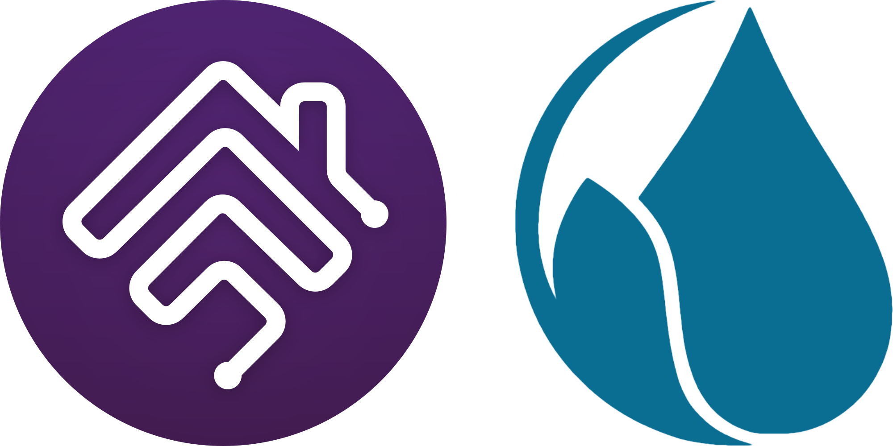

<!-- MASTHEAD:BEGIN - Auto-generated by homebridge-plugin-utils. Do not edit this region by hand. -->

# Homebridge Hunter Hydrawise

[![verified-by-homebridge](https://img.shields.io/badge/homebridge-verified-blueviolet?color=%2357277C&style=for-the-badge&logoColor=%23FFFFFF&logo=data:image/svg%2bxml;base64,PHN2ZyB4bWxucz0iaHR0cDovL3d3dy53My5vcmcvMjAwMC9zdmciIHdpZHRoPSI5OTIuMDkiIGhlaWdodD0iMTAwMCIgdmlld0JveD0iMCAwIDk5Mi4wOSAxMDAwIj48ZGVmcz48c3R5bGU+LmF7ZmlsbDojZmZmO308L3N0eWxlPjwvZGVmcz48cGF0aCBjbGFzcz0iYSIgZD0iTTk1MC4xOSw1MDguMDZhNDEuOTEsNDEuOTEsMCwwLDEtNDItNDEuOWMwLS40OC4zLS45MS4zLTEuNDJMODI1Ljg2LDM4Mi4xYTc0LjI2LDc0LjI2LDAsMCwxLTIxLjUxLTUyVjEzOC4yMmExNi4xMywxNi4xMywwLDAsMC0xNi4wOS0xNkg3MzYuNGExNi4xLDE2LjEsMCwwLDAtMTYsMTZWMjc0Ljg4bC0yMjAuMDktMjEzYTE2LjA4LDE2LjA4LDAsMCwwLTIyLjY0LjE5TDYyLjM0LDQ3Ny4zNGExNiwxNiwwLDAsMCwwLDIyLjY1bDM5LjM5LDM5LjQ5YTE2LjE4LDE2LjE4LDAsMCwwLDIyLjY0LDBMNDQzLjUyLDIyNS4wOWE3My43Miw3My43MiwwLDAsMSwxMDMuNjIuNDVMODYwLDUzOC4zOGE3My42MSw3My42MSwwLDAsMSwwLDEwNGwtMzguNDYsMzguNDdhNzMuODcsNzMuODcsMCwwLDEtMTAzLjIyLjc1TDQ5OC43OSw0NjguMjhhMTYuMDUsMTYuMDUsMCwwLDAtMjIuNjUuMjJMMjY1LjMsNjgwLjI5YTE2LjEzLDE2LjEzLDAsMCwwLDAsMjIuNjZsMzguOTIsMzlhMTYuMDYsMTYuMDYsMCwwLDAsMjIuNjUsMGwxMTQtMTEyLjM5YTczLjc1LDczLjc1LDAsMCwxLDEwMy4yMiwwbDExMywxMTEsLjQyLjQyYTczLjU0LDczLjU0LDAsMCwxLDAsMTA0TDU0NS4wOCw5NTcuMzV2LjcxYTQxLjk1LDQxLjk1LDAsMSwxLTQyLTQxLjk0Yy41MywwLC45NS4zLDEuNDQuM0w2MTYuNDMsODA0LjIzYTE2LjA5LDE2LjA5LDAsMCwwLDQuNzEtMTEuMzMsMTUuODUsMTUuODUsMCwwLDAtNC43OS0xMS4zMmwtMTEzLTExMWExNi4xMywxNi4xMywwLDAsMC0yMi42NiwwTDM2Ny4xNiw3ODIuNzlhNzMuNjYsNzMuNjYsMCwwLDEtMTAzLjY3LS4yN2wtMzktMzlhNzMuNjYsNzMuNjYsMCwwLDEsMC0xMDMuODZMNDM1LjE3LDQyNy44OGE3My43OSw3My43OSwwLDAsMSwxMDMuMzctLjlMNzU4LjEsNjM5Ljc1YTE2LjEzLDE2LjEzLDAsMCwwLDIyLjY2LDBsMzguNDMtMzguNDNhMTYuMTMsMTYuMTMsMCwwLDAsMC0yMi42Nkw1MDYuNSwyNjUuOTNhMTYuMTEsMTYuMTEsMCwwLDAtMjIuNjYsMEwxNjQuNjksNTgwLjQ0QTczLjY5LDczLjY5LDAsMCwxLDYxLjEsNTgwTDIxLjU3LDU0MC42OWwtLjExLS4xMmE3My40Niw3My40NiwwLDAsMSwuMTEtMTAzLjg4TDQzNi44NSwyMS40MUE3My44OSw3My44OSwwLDAsMSw1NDAsMjAuNTZMNjYyLjYzLDEzOS4zMnYtMS4xYTczLjYxLDczLjYxLDAsMCwxLDczLjU0LTczLjVINzg4YTczLjYxLDczLjYxLDAsMCwxLDczLjUsNzMuNVYzMjkuODFhMTYsMTYsMCwwLDAsNC43MSwxMS4zMmw4My4wNyw4My4wNWguNzlhNDEuOTQsNDEuOTQsMCwwLDEsLjA4LDgzLjg4WiIvPjwvc3ZnPg==)](https://github.com/homebridge/homebridge/wiki/Verified-Plugins)

## Hunter Hydrawise support for [Homebridge](https://homebridge.io).

<!-- MASTHEAD:END -->

`homebridge-hunter-hydrawise` is a [Homebridge](https://homebridge.io) plugin that makes your Hunter Hydrawise irrigation controller available to [Apple's](https://www.apple.com) [HomeKit](https://www.apple.com/ios/home) smart home platform.

### Feature Options

Feature options allow you to enable or disable certain features in this plugin. These feature options provide unique flexibility by also allowing you to set a scope for each option that allows you more granular control in how this plugin makes features and capabilities available in HomeKit.

The priority given to these options works in the following order, from highest to lowest priority where settings that are higher in priority will override the ones below:

  * Zone options that are enabled or disabled.
  * Controller options that are enabled or disabled.
  * Global options that are enabled or disabled.

All feature options can be set at any scope level, or at multiple scope levels. If an option isn't applicable to a particular scope, it is ignored. A zone option overrides a controller option, a controller option overrides a global option, and a global option overrides the plugin default. If you want to override a global feature option you've set, you can override it for an individual controller or zone, if you choose.

> [!IMPORTANT]
> It's strongly recommended that you use the Homebridge webUI](https://github.com/homebridge/homebridge-config-ui-x) to configure this plugin - it's easier to use for most people, and will ensure you always have a valid configuration.**

### Feature Options Reference
Feature options provide a rich mechanism for tailoring your `homebridge-hunter-hydrawise` experience. The reference below is divided into functional category groups:

<!-- FEATURE OPTIONS:BEGIN - Auto-generated by homebridge-plugin-utils. Do not edit this region by hand. -->
 * [Account](#account): Account feature options.
 * [Device](#device): Device feature options.
 * [Log](#log): Logging feature options.
 * [Mqtt](#mqtt): MQTT

Options whose key ends in `=<value>` take a value - replace `=<value>` with your setting; all other options are simple on/off toggles. The default shown for each option is what applies when you leave it unset.

#### Account feature options.

| Option                                                     | Description
|------------------------------------------------------------|-------------------------------------------------------------
| `Account.ApiKey=<value>`      | The API key for your Hydrawise account, generated under Account Details → Account Settings on the Hydrawise website. **(default: none)**.  *Configurable globally across every controller.*
| `Account.Username=<value>`  | The username for your Hydrawise account, which is the email address you sign in with. Optional: setting it alongside your password enables enhanced features - accurate rain and suspension state for each zone, whether each controller is reachable, and its real model and firmware details in HomeKit and the webUI. **(default: none)**.  *Configurable globally across every controller.*
| `Account.Password=<value>`  | The password for your Hydrawise account. Optional: setting it alongside your username enables enhanced features - accurate rain and suspension state for each zone, whether each controller is reachable, and its real model and firmware details in HomeKit and the webUI. **(default: none)**.  *Configurable globally across every controller.*

#### Device feature options.

| Option                                                   | Description
|----------------------------------------------------------|-------------------------------------------------------------
| `Device`                            | Make this device available in HomeKit. **(default: enabled)**.  *Configurable on the whole controller, on each zone, or globally across every controller.*
| `Device.Name=<value>`          | Custom HomeKit name for this zone or controller. When set to a name HomeKit can use, it always applies, and a rename made in the Home app yields to it. Otherwise, the name reported by Hydrawise is used, and where HomeKit cannot use that either, such as a name of only emoji or punctuation, a zone is named by its number, as in Zone 3, and a controller is named Controller. **(default: none)**.  *Configurable on the whole controller or on each zone.*
| `Device.Standalone`      | Expose this zone as its own HomeKit accessory, assignable to any room. Toggling this changes the zone's HomeKit identity, so automations, scenes, and room assignments tied to it must be recreated. **(default: disabled)**.  *Configurable on the whole controller, on each zone, or globally across every controller.*
| `Device.Suspend.All`    | Enable a switch accessory that suspends and resumes every zone on the controller at once. **(default: disabled)**.  *Configurable on the whole controller or globally across every controller.*
| `Device.Suspend.Zone`  | Enable a switch accessory that suspends and resumes an individual zone. Requires your Hydrawise account login (enhanced features). **(default: disabled)**.  *Configurable on the whole controller, on each zone, or globally across every controller.*
| `Device.SyncName`          | Keep zone and controller names in step with the names Hydrawise reports (Hydrawise → HomeKit) when no Name is set. When disabled, the reported name is set once when its HomeKit service is created, and a rename made in the Home app stands. While enabled, the settings page shows each name as HomeKit carries it. **(default: enabled)**.  *Configurable on the whole controller, on each zone, or globally across every controller.*

#### Logging feature options.

| Option                               | Description
|--------------------------------------|-------------------------------------------------------------
| `Log.Debug`  | Enable debug logging. **(default: disabled)**.  *Configurable globally across every controller.*
| `Log.Zone`    | Log zone start and stop events in Homebridge. **(default: enabled)**.  *Configurable on the whole controller, on each zone, or globally across every controller.*

#### MQTT

| Option                                         | Description
|------------------------------------------------|-------------------------------------------------------------
| `Mqtt.Url=<value>`      | URL of the MQTT broker to connect to (e.g. mqtt://1.2.3.4). **(default: none)**.  *Configurable globally across every controller.*
| `Mqtt.Topic=<value>`  | Topic prefix for published and subscribed MQTT messages. **(default: hydrawise)**.  *Configurable globally across every controller.*

<!-- FEATURE OPTIONS:END -->

---

## Documentation
<!-- DOCUMENTATION:BEGIN - Auto-generated by homebridge-plugin-utils. Do not edit this region by hand. -->
* Getting Started
  * [Installation](https://github.com/hjdhjd/homebridge-hunter-hydrawise/blob/main/README.md#installation): installing this plugin, including system requirements.
  * [Additional Notes](https://github.com/hjdhjd/homebridge-hunter-hydrawise/blob/main/README.md#notes): some things you should be aware of, including Hydrawise-specific quirks.
  * [Changelog](https://github.com/hjdhjd/homebridge-hunter-hydrawise/blob/main/docs/Changelog.md): changes and release history of this plugin.

* Advanced Topics
  * [MQTT](https://github.com/hjdhjd/homebridge-hunter-hydrawise/blob/main/docs/MQTT.md): how to configure MQTT support.
<!-- DOCUMENTATION:END -->
